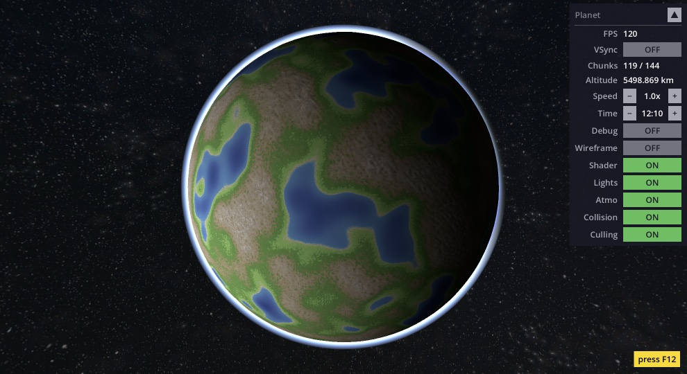
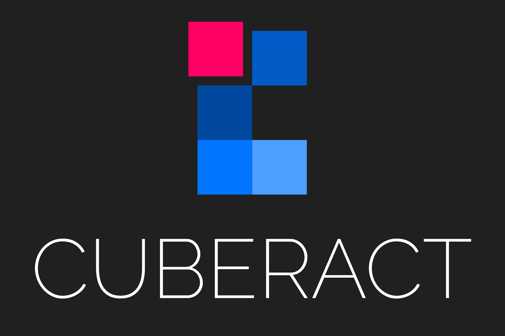

# **SPARTAN-II Video Game Nasa Space App Challenger 2026**

  
https://github.com/user-attachments/assets/fcda8ca2-a0b4-4aa0-ab11-415dbae62abb

**Link Video Game SPARTAN-II**
Below you will find the access link to our video game:

    spartan-ii-the-gamme.vercel.app

# **Chunked LOD Planet:**
A procedurally generated planet with dynamic level-of-detail, written entirely in GDScript for Godot 4.6. Designed as a **learning resource** — read this document first, then explore the code.

  

where the atmospheric path is longest. Near the terminator (day/night boundary), the atmosphere takes on warm sunset tones.

## **License:**
MIT — use it however you like. If you build something cool with it, I'd love to hear about it.

## **Author:**

I'm a solo indie developer building tools and games with Godot Engine under the **Cuberact** label. This planet project started as a Java/Ardor3D experiment about 15 years ago — now rewritten for Godot as a learning resource for the community.

More projects at [cuberact.org](https://www.cuberact.org).

## **Team members Spartans-II**

  

Copyright: © https://github.com/0Kelly087 Created by: © KELLY-087\
Copyright: © https://github.com/GeraldMo-479 Created by: ©GERALD-479\
Copyright: © https://github.com/RAYZER-117 Created by: ©RAYZER-117\
Copyright: © https://github.com/Julio-020 Created by: ©JULIO-020\
Copyright: © https://github.com/dg2c4 Created by: © DAID-204

